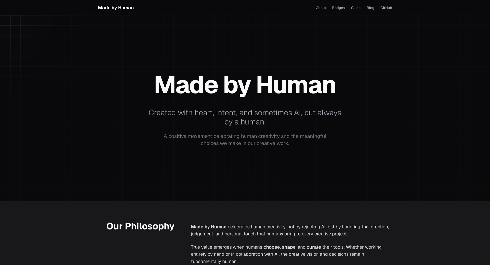

# Made by Human

Celebrating human creativity, not by rejecting AI but by honoring the intention, judgement and personal touch people bring to creative work.

<p>
  Free SVG badges, open source under MIT · <a href="https://madebyhuman.iamjarl.com/badges">Browse badges</a> · <a href="https://madebyhuman.iamjarl.com/about">About the project</a> · <a href="https://madebyhuman.iamjarl.com/blog">Read the blog</a>
</p>

<p>
  <a href="https://madebyhuman.iamjarl.com"></a>
</p>

The four badges say who made a piece of work and how. Crafted by Human is for work made without AI, Made by Human for any work where a person made the creative decisions, Co-created with AI for work that AI tools helped with, and Human in the Loop for AI-heavy work that a person guides and signs off. They are for developers, writers, designers and artists who want to be open about their process. Pick the one that is true for your work, copy its embed code from the [badge gallery](https://madebyhuman.iamjarl.com/badges), and paste it where the work lives. A badge is your own word on how something was made, not a certificate.

## For developers

<p>
  <a href="https://madebyhuman.iamjarl.com"><picture>
    <source media="(prefers-color-scheme: dark)" srcset="https://madebyhuman.iamjarl.com/badges/co-created-white.svg">
    </picture></a>
  <a href="https://github.com/JarlLyng/madebyhuman/actions/workflows/deploy.yml"></a>
  <a href="LICENSE"></a>
</p>

How to put a badge on your own project, how to run the site locally, how to contribute, and the license.

### Using the badges

<p>
  <picture>
    <source media="(prefers-color-scheme: dark)" srcset="https://madebyhuman.iamjarl.com/badges/made-white.svg">
    </picture>
  <picture>
    <source media="(prefers-color-scheme: dark)" srcset="https://madebyhuman.iamjarl.com/badges/co-created-white.svg">
    </picture>
  <picture>
    <source media="(prefers-color-scheme: dark)" srcset="https://madebyhuman.iamjarl.com/badges/crafted-white.svg">
    </picture>
  <picture>
    <source media="(prefers-color-scheme: dark)" srcset="https://madebyhuman.iamjarl.com/badges/loop-white.svg">
    </picture>
</p>

Every badge is a static SVG at `https://madebyhuman.iamjarl.com/badges/<name>-<white|black>.svg`, where the name is `made`, `co-created`, `crafted` or `loop`. The white badge is for dark backgrounds and the black one for light backgrounds. Each snippet links the badge back to the site.

In Markdown, for a README:

```markdown
[](https://madebyhuman.iamjarl.com)
```

In HTML, for a website:

```html
<a href="https://madebyhuman.iamjarl.com">
  
</a>
```

For a badge that follows the reader's light or dark theme on GitHub, the way the ones above do:

```html
<a href="https://madebyhuman.iamjarl.com"><picture>
  <source media="(prefers-color-scheme: dark)" srcset="https://madebyhuman.iamjarl.com/badges/made-white.svg">
  </picture></a>
```

The [badge gallery](https://madebyhuman.iamjarl.com/badges) has a download and a copy button for every badge, and the [guide](https://madebyhuman.iamjarl.com/guide) walks through choosing one.

### Running the site locally

You need Node.js 20.9 or newer.

```bash
npm install
npm run dev
```

The site runs at [http://localhost:3000](http://localhost:3000). `npm run build` writes the sitemap and the RSS feed, then exports the static site to `out/`, and `npm run lint` runs ESLint. The optional environment variables are in `.env.example`, and the code falls back to the production values without them.

It is a static Next.js site (App Router, React 19, Tailwind CSS v4, TypeScript, Framer Motion). `src/lib/badges.ts` holds the names and descriptions of the badges, and `src/app/config.ts` builds the embed codes. Blog posts are MDX files with frontmatter in `src/content/blog/`. Every push to `main` deploys to GitHub Pages through [`deploy.yml`](.github/workflows/deploy.yml).

### Contributing

Badges, ideas, text, design and code are all welcome. Read [CONTRIBUTING.md](CONTRIBUTING.md) first, and use [GitHub Issues](https://github.com/JarlLyng/madebyhuman/issues) for bugs and suggestions.

### License

[MIT](LICENSE). Made by Human is made by Jarl at [IAMJARL](https://iamjarl.com).
